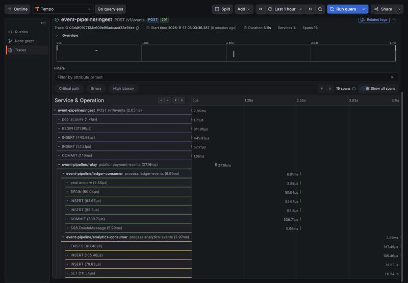
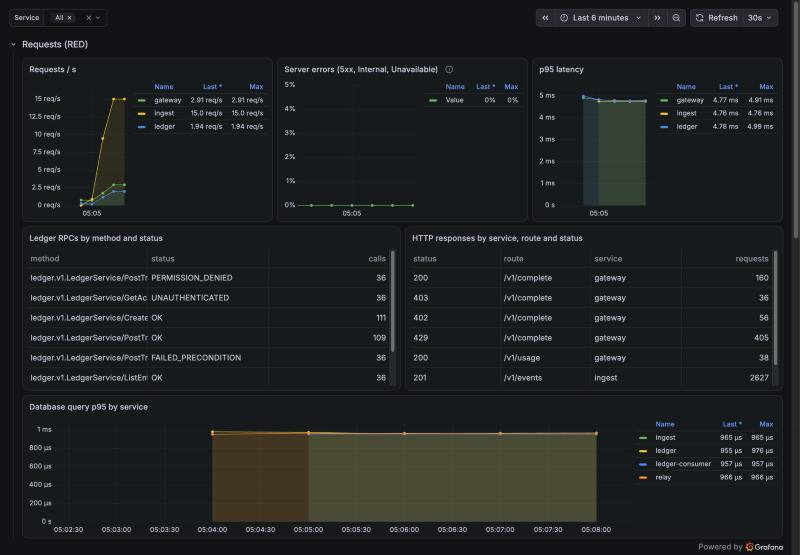
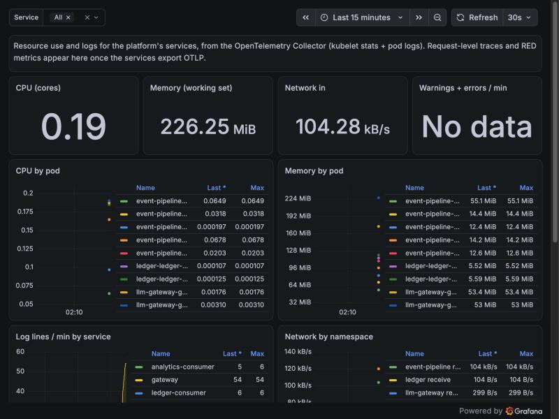
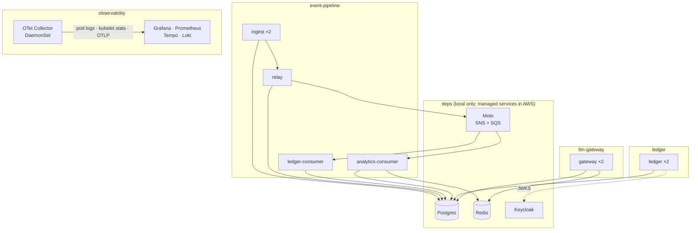

# platform

[](https://github.com/learnercys/platform/actions/workflows/ci.yml)

Deployment and infrastructure for three services:
[event-pipeline](https://github.com/learnercys/event-pipeline),
[ledger](https://github.com/learnercys/ledger) and
[llm-gateway](https://github.com/learnercys/llm-gateway).

- **Helm:** one hardened library chart, and a chart per service built on it
- **Local Kubernetes:** `make up` runs all three services on kind, with
  stand-ins for the AWS managed services and a full observability stack
- **OpenTelemetry:** every service is instrumented, and one Collector
  pipeline carries logs, metrics and traces. A payment event can be followed
  from the HTTP request through the outbox, SNS and SQS to both consumers.
  Two provisioned Grafana dashboards are generated from code.
- **Terraform for AWS:** VPC, EKS, RDS, ElastiCache, SNS/SQS with DLQs, ECR,
  least-privilege Pod Identity roles, and keyless GitHub → ECR pushes
- **CI:** Helm lint, schema validation, Terraform validate + tflint, Trivy
  security scans, and an end-to-end deploy on kind

```
$ make up && make smoke
==> event-pipeline: 500 events (30% duplicates) through ingest -> outbox -> SNS -> SQS -> both consumers
✅  every unique event stored exactly once        500   500
✅  ledger: balances match                        no differences
✅  analytics: daily totals match                 no differences
PASS: every event was applied exactly once by every consumer

==> ledger: the curl demo with real Keycloak tokens
==> Alice pays Bob $25.00, and the client retries with the same idempotency key   [HTTP 200] [HTTP 200]
==> globex can't see acme's accounts, even with the exact ID                      [HTTP 404]

==> llm-gateway: fallback, cache, permissions, budget
200 200 200 200 200 402 402 402 402 402 429 429

PASS: all three services work end to end in Kubernetes
```

**One payment event, traced across four processes and two languages.** It
goes from the ingest API through the transactional outbox, SNS and SQS to both
consumers. Trace context rides in the outbox row and the message attributes.



| Service health (RED, LLM usage, traces) | Platform overview (resources, logs) |
|---|---|
|  |  |

## What's in the cluster



| Host port | What |
|---|---|
| 53000 | Grafana (anonymous admin) → *Dashboards › Platform* (Service health, Platform overview) |
| 58080 | event-pipeline ingest API |
| 58090 | ledger (gRPC + HTTP/JSON) |
| 58180 | Keycloak (ledger tokens) |
| 58000 | llm-gateway |
| 55432 / 55000 | Postgres / Moto, for the event-pipeline verifier |

These are the same ports each service repo uses with Docker Compose, so their
demo and verification scripts run unchanged against the cluster.

## Run it

You need Docker, Go, Helm 4, kind and kubectl. The Terraform and linter
tools run from containers.

```bash
make up                 # kind cluster, build + load images, deps, observability, services (~3.5 min)
make smoke              # end-to-end checks using each service repo's own tools
make lint               # everything CI checks, locally
make down
```

`make up` clones the service repos next to this one if they're missing
(`REPOS_DIR=..`), builds their images, and loads them into kind, so nothing
is pulled from a registry. Export `ANTHROPIC_API_KEY` first to give
llm-gateway a real model; otherwise its default route falls through to the
fake provider.

## Layout

```
charts/
  service-lib/      library chart: hardened Deployment, Service, HPA, PDB, migrations Job
  event-pipeline/   4 components + SNS/SQS bootstrap Job (local only)
  ledger/           RLS-enforcing app role for the service, owner role for migrations
  llm-gateway/      routes/prices/tenants config mounted from the service repo
  dev-deps/         Postgres, Redis, Moto, Keycloak: local stand-ins, never deployed to AWS
  observability/    OTel Collector DaemonSet, otel-lgtm, Grafana dashboards
local/kind.yaml     cluster + host port mappings
infra/terraform/
  modules/          messaging, data, service-identity, ecr, github-oidc
  envs/staging/     VPC + EKS (community modules) wired to the modules above
scripts/            smoke.sh, lint.sh, dashboards.py (generates the dashboard JSON)
docs/adr/           design decisions
```

## Decisions

| | |
|---|---|
| [ADR 1: one library chart](docs/adr/0001-shared-library-chart.md) | Every pod is non-root (numeric UID), has a read-only root filesystem, drops all capabilities, and gets OTel config and idempotent migrations by default. Trivy finds no HIGH/CRITICAL issues in the rendered service charts. |
| [ADR 2: local environment mirrors AWS](docs/adr/0002-local-environment.md) | Same charts as production, with stand-ins for managed services. Running on Kubernetes found a real replica-startup race in llm-gateway, now fixed upstream with a test. |
| [ADR 3: one OTel pipeline](docs/adr/0003-observability-pipeline.md) | Pod logs and resource metrics from the node, and traces and RED metrics from the instrumented services. The backend is swappable in one exporter block. |
| [ADR 4: AWS in Terraform](docs/adr/0004-aws-with-terraform.md) | Community modules for VPC/EKS; own modules for messaging, data, identity. Pod Identity, KMS, keyless CI. Accepted Trivy findings are written down. |

## Honest status

- **Terraform is validated, linted and security-scanned, not applied.**
  Applying it creates billable resources (roughly $350–400/month for staging
  as sized). `plan` needs an AWS account.
- Not yet included: External Secrets Operator, AWS Load Balancer Controller,
  Argo CD for GitOps delivery, and VPC endpoints to remove NAT egress.
